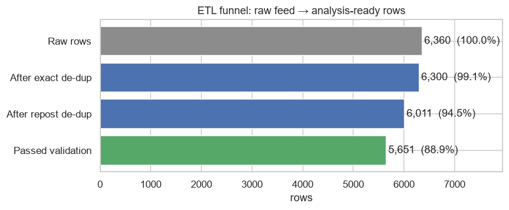
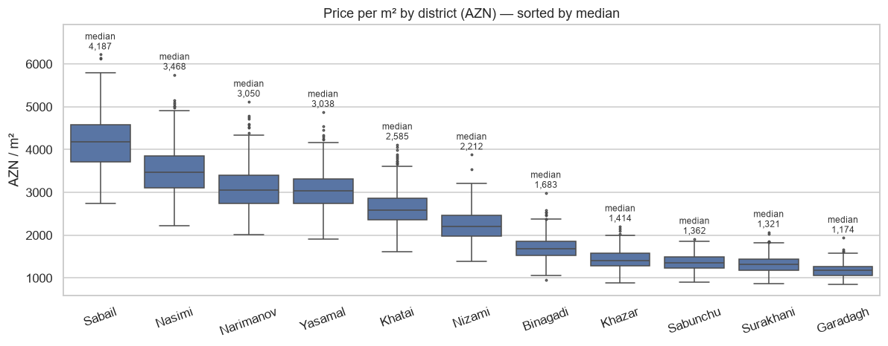
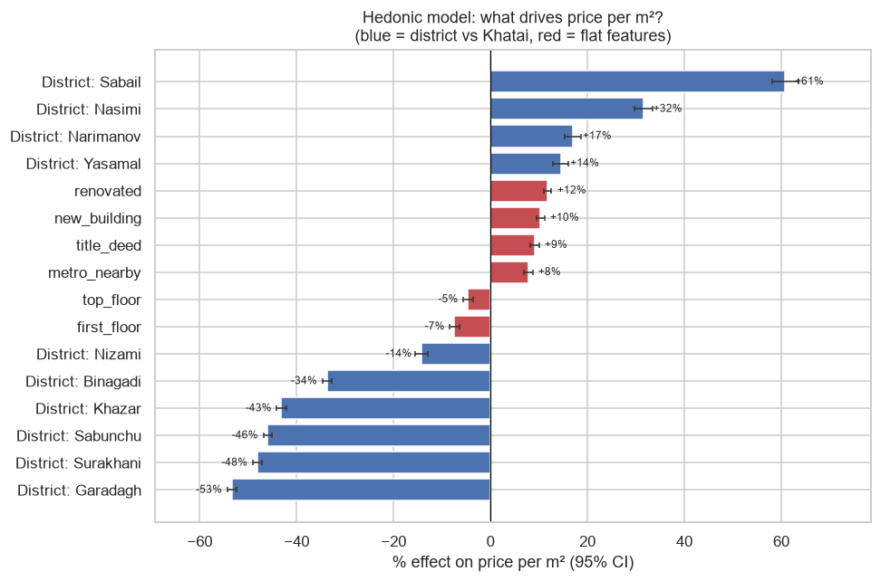
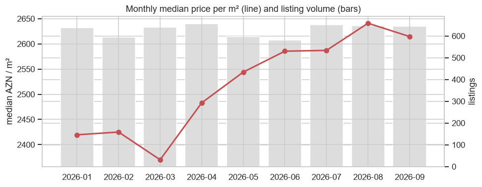
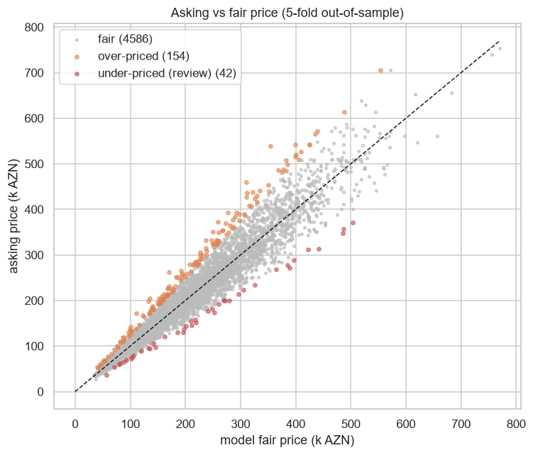

# Baku Apartment Listings — ETL Pipeline & Hedonic Price Model

**Daily Data Analytics Project · Day 07**

## Business question
A Baku property portal receives a messy listings feed. **How much of it is usable, and once it is clean, what actually drives the price per m²?**

1. **Data engineering** — turn a raw export (USD/AZN prices, `125k AZN`, `98,7 kv.m`, 40 district spellings such as `Nəsimi / NƏSİMİ / nesimi r.`, two date formats, reposts, fat-finger typos) into a validated table in CSV + SQLite.
2. **Analytics** — estimate the premium for district, new building, renovation, title deed (*çıxarış*), metro access and floor with a log-linear **hedonic regression**, then flag mispriced listings for moderators.

## Key KPIs (from the executed notebook)
| KPI | Value |
|---|---|
| Raw rows → clean rows | 6,360 → 5,651 (**88.9% usable**) |
| Duplicates removed (exact + reposts) | 60 + 289 |
| Rows quarantined by validation rules | 360 |
| Prices converted from USD | 17.7% |
| Median price / median price per m² | AZN 193,000 / AZN 2,517 |
| Most / least expensive district (median AZN/m²) | Sabail 4,187 / Garadagh 1,174 |
| Hedonic model fit (5-fold CV) | R² = 0.914 on log price/m², MAPE = 9.7% on price |
| Listings priced >25% below fair value | 42 (0.9%) |

## ETL pipeline
```
raw_listings.csv ──► standardize ──► de-duplicate ──► validate ──► transform ──► clean_listings.csv
  (strings)          types, units,    exact rows +     6 plausibility   price/m²,      listings.db (SQLite)
                     currency, AZ     reposts of the   rules → rows     floor flags,
                     spellings        same flat        quarantined      month
```
Post-load assertions (unique ids, no nulls in key fields, 11 districts, ranges, floor ≤ total floors) fail the run loudly if broken.



## Charts





## Findings & recommendations
| Area | Evidence | Recommendation |
|---|---|---|
| Feed quality | Only 88.9% of raw rows usable; 349 duplicates/reposts, 360 rows failed validation | Validate at upload: numeric price + currency dropdown, district picklist, area in m² only; block reposts of the same flat |
| Currency | 17.7% of prices quoted in USD | Store price and currency separately; show both on the card |
| Location | Garadagh −53% to Sabail +61% per m² vs Khatai | District as the first filter and in price-alert defaults |
| Legal status | Title deed (*çıxarış*) adds **+9.2%** per m² | Make "title deed" a mandatory, verified badge |
| Condition | Renovation +11.8%, new building +10.3%, metro +7.9% | Structured filters instead of free text |
| Floor | Ground floor −7.4%, top floor −4.7% | Show floor as "X / Y" with ground/top badges |
| Market trend | +0.82% per month, controlling for listing mix | Refresh the fair-price model monthly |
| Moderation | 42 listings priced >25% below fair value | Auto-queue them for fraud/bait review before publishing |

**Why a model and not simple averages?** Naively, new buildings look 1% *cheaper* per m² and metro access looks +82% — both are confounded by location (new builds cluster in cheaper outer districts, metro in the centre). Controlling for district, the true effects are +10.3% and +7.9%.

## Tech stack
Python · pandas (regex parsing, validation) · NumPy (OLS with standard errors) · SciPy · scikit-learn (cross-validation) · SQLite · matplotlib · seaborn · nbformat

## Structure
```
data/generate_data.py      synthetic messy feed generator (seed 42)
data/raw_listings.csv      6,360 raw rows as "scraped"
data/clean_listings.csv    5,651 validated rows
data/listings.db           clean table in SQLite (table: listings)
etl.py                     extract → standardize → de-dup → validate → load
build_notebook.py          builds the notebook
housing_etl_pricing.ipynb  executed analysis
images/                    charts
```

## Run
```bash
pip install -r requirements.txt
python data/generate_data.py
python etl.py
python build_notebook.py
python -m nbconvert --to notebook --execute --inplace housing_etl_pricing.ipynb
```

> **Note:** all data is synthetic and contains no real listings or personal information. District price levels are illustrative.

## 🇦🇿 Azərbaycanca xülasə
Bakı daşınmaz əmlak portalının qarışıq elan axını (dollar/manat qiymətlər, "125k AZN", "98,7 kv.m", rayon adlarının 40 fərqli yazılışı, təkrar elanlar, səhv rəqəmlər) ETL pipeline ilə təmizlənib SQLite-a yüklənib: 6,360 sətirdən 5,651-i (88.9%) istifadəyə yararlıdır. Hedonik reqressiya göstərir ki, m² qiymətinə ən çox rayon təsir edir (Qaradağ −53%, Səbail +61%, Xətai ilə müqayisədə), təmir +11.8%, yeni tikili +10.3%, çıxarış +9.2%, metro +7.9% əlavə edir; 1-ci mərtəbə −7.4% ucuzdur. Model qiyməti 9.7% orta xəta ilə proqnozlaşdırır və bazar dəyərindən 25%+ ucuz olan 42 elanı moderasiya üçün işarələyir. Data sintetikdir.
